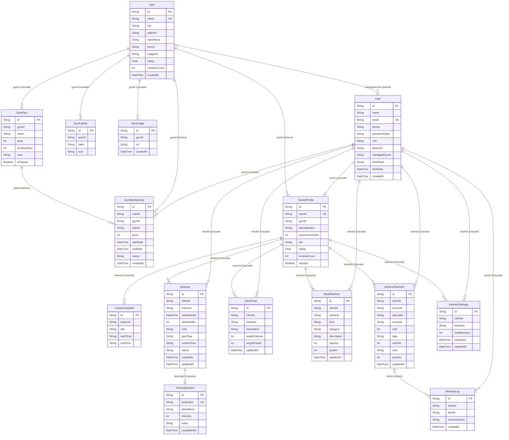

# Entitas Backend

Setiap tabel database punya satu kelas entitas TypeScript. Backend memakai **Prisma** sebagai ORM, jadi
sumber kebenaran struktur tabel tetap `backend/prisma/schema.prisma`; kelas entitas ini mencerminkannya
(tipe data tiap kolom + relasi) supaya kode dan dokumentasi mudah dibaca, dan bisa dipakai sebagai tipe
data di service/DTO.

Impor semuanya dari satu tempat:

```ts
import { UserEntity, BookingEntity } from '../entities';   // src/entities/index.ts
```

Relasi ditulis sebagai properti opsional (`client?: UserEntity`) karena hanya terisi bila query memakai `include`.
Kolom opsional di database bertipe `| null`.

| Entitas | Berkas | Isi |
|---|---|---|
| `UserEntity` | `src/modules/users/entities/user.entity.ts` | Akun semua peran (MEMBER, TRAINER, ADMIN) |
| `GymEntity` | `src/modules/gyms/entities/gym.entity.ts` | Cabang gym |
| `GymFacilityEntity` | `src/modules/gyms/entities/gym-facility.entity.ts` | Fasilitas gym |
| `GymImageEntity` | `src/modules/gyms/entities/gym-image.entity.ts` | Foto gym |
| `GymPlanEntity` | `src/modules/gyms/entities/gym-plan.entity.ts` | Paket membership gym (harga, durasi) |
| `GymMembershipEntity` | `src/modules/gym-memberships/entities/gym-membership.entity.ts` | Membership aktif/riwayat milik user |
| `TrainerProfileEntity` | `src/modules/trainers/entities/trainer-profile.entity.ts` | Profil Personal Trainer |
| `TrainerScheduleEntity` | `src/modules/trainer-schedules/entities/trainer-schedule.entity.ts` | Jam ketersediaan mingguan PT |
| `BookingEntity` | `src/modules/bookings/entities/booking.entity.ts` | Booking sesi PT (status, tujuan, tujuan bebas) |
| `TrainingSessionEntity` | `src/modules/training-sessions/entities/training-session.entity.ts` | Catatan sesi yang selesai |
| `ClientGoalEntity` | `src/modules/client-goals/entities/client-goal.entity.ts` | Target kalori/makro klien dari PT |
| `MealPlanItemEntity` | `src/modules/meal-plans/entities/meal-plan-item.entity.ts` | Menu makan klien dari PT |
| `WorkoutPlanItemEntity` | `src/modules/workout-plans/entities/workout-plan-item.entity.ts` | Gerakan program latihan dari PT |
| `WorkoutLogEntity` | `src/modules/workout-plans/entities/workout-log.entity.ts` | Log gerakan yang dicentang klien |
| `SessionPackageEntity` | `src/modules/session-packages/entities/session-package.entity.ts` | Kuota sesi PT per klien (default 8) |

> Bila `schema.prisma` berubah (kolom/tabel baru), perbarui kelas entitas terkait dan diagram di bawah.

## Diagram relasi (ERD)

Buka di GitHub / VS Code (ekstensi Mermaid) untuk melihat gambarnya. Teks dalam kurung pada garis relasi
adalah aturan hapus: `Cascade` = ikut terhapus, `Restrict` = ditolak bila masih dipakai, `SetNull` = diisi kosong.


